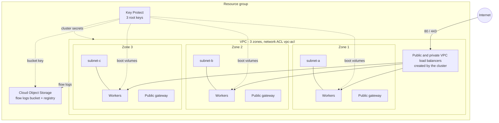

# VPC + Red Hat OpenShift (ROKS) on IBM Cloud

Terraform configuration that builds a container platform: a three-zone VPC with subnets,
public gateways and network ACLs, a Red Hat OpenShift cluster across all three zones, and the
VPC load balancers that IBM Cloud creates for the cluster Ingress. Cluster secrets, worker boot
volumes and Object Storage are encrypted with customer-managed Key Protect keys.

The configuration is composed from [Terraform IBM Modules (TIM)](https://github.com/terraform-ibm-modules).
Module choices and wiring were taken from the TIM MCP server, the `base-ocp-vpc` `advanced`
example and its `fully-configurable` deployable architecture.

## Architecture



## Modules

| Purpose | Module | Version |
|---|---|---|
| Resource group | `terraform-ibm-modules/resource-group/ibm` | 1.6.1 |
| Key Protect, key rings, root keys | `terraform-ibm-modules/kms-all-inclusive/ibm` | 5.6.15 |
| Object Storage instance and flow-log bucket | `terraform-ibm-modules/cos/ibm` | 11.1.4 |
| VPC, subnets, public gateways, ACLs, flow logs | `terraform-ibm-modules/landing-zone-vpc/ibm` | 10.1.5 |
| OpenShift cluster, worker pools, registry storage | `terraform-ibm-modules/base-ocp-vpc/ibm` | 4.0.7 |

Provider: `IBM-Cloud/ibm` `>= 2.8.0, < 3.0.0`. Terraform: `>= 1.9.0`.

## What is created

- **Network**: one VPC, one worker subnet and one public gateway in each of the three zones,
  and one network ACL. The default security group and ACL rules are removed
  (`clean_default_sg_acl`).
- **Network ACL** allows: IBM Cloud IaaS/PaaS ranges, traffic between VPC address prefixes, the
  instance metadata service, inbound 80/443 from `public_ingress_cidrs` (and the replies), and
  outbound 80/443 through the public gateways. Everything else is denied.
- **OpenShift**: one cluster with the default worker pool in all three zones. Secrets are
  encrypted with one Key Protect root key and boot volumes with a second.
- **Load balancers**: IBM Cloud creates the public and private VPC load balancers for the
  cluster Ingress in the worker subnets and secures them with the managed
  `kube-lbaas-<cluster-id>` security group. They are not Terraform resources, so they do not
  appear in the state.
- **Encryption**: Key Protect with three root keys (cluster, boot volume, Object Storage), plus
  IAM service authorizations that let Kubernetes Service and Block Storage for VPC use them.
- **Object Storage**: one instance, shared by the VPC flow-log bucket (KMS-encrypted) and the
  OpenShift internal image registry.

## Usage

```sh
export TF_VAR_ibmcloud_api_key="<your IBM Cloud API key>"   # never commit this
cp terraform.tfvars.example terraform.tfvars                # then edit prefix, region, ...
terraform init
terraform plan
terraform apply
```

Cluster creation takes 30-60 minutes. During apply the `base-ocp-vpc` module runs `kubectl`
health checks on the machine running Terraform and downloads `kubectl` and `jq` if they are
missing, so that machine needs internet access or those tools pre-installed.

### Prerequisites

- An IBM Cloud account with permission to create VPC, Kubernetes Service, Key Protect, Object
  Storage and IAM authorization resources.
- Service endpoints enabled for the account: `ibmcloud account update --service-endpoint-enable true`.
- Any tags listed in `access_tags` must already exist.

### Key inputs

| Variable | Default | Notes |
|---|---|---|
| `prefix` | required | 1-16 chars, prefixes every resource name |
| `region` | `us-south` | must have three zones |
| `existing_resource_group_name` | `null` | `null` creates `<prefix>-resource-group` |
| `vpc_subnet_cidrs` | `10.10.10.0/24`, `10.20.10.0/24`, `10.30.10.0/24` | one per zone, inside `10.0.0.0/8` |
| `public_ingress_cidrs` | `["0.0.0.0/0"]` | exactly one CIDR (ACL rule limit) |
| `worker_machine_type` / `workers_per_zone` | `bx2.4x16` / `2` | |
| `worker_operating_system` | `RHCOS` | or `RHEL_9_64` |
| `disable_public_endpoint` | `false` | `true` makes a private-only cluster, not reversible |
| `disable_outbound_traffic_protection` | `false` | `true` allows public egress, needed for OperatorHub |
| `create_kms_authorization_policies` | `true` | set `false` if equivalent account-wide policies exist |
| `kms_force_delete` | `false` | set `true` only for throw-away environments |

## Security notes

- The public load balancers accept HTTP/HTTPS from `public_ingress_cidrs`, which defaults to the
  whole internet because the platform is meant to serve public applications. Narrow it for
  anything that should not be public.
- Outbound protection is on by default, so workloads cannot reach the public internet. Enable
  `disable_outbound_traffic_protection` only if you need OperatorHub or public registries.
- `terraform.tfvars`, state files and kubeconfig files are git-ignored. State contains
  sensitive values, so use an encrypted remote backend with restricted access for real use.
- Key Protect keys are not force-deleted by default, so `terraform destroy` can fail while the
  cluster or bucket still uses a key. Set `kms_force_delete` for disposable environments.

## Validation status

Run locally with Terraform 1.17.0:

- `terraform fmt -check -recursive`: passes
- `terraform init -backend=false` and `terraform validate`: pass

Not verified: `terraform plan` and `terraform apply` need an IBM Cloud API key and were not run,
so the network ACL rules and the cluster-to-KMS wiring have not been tested against a real
account. Review the first plan carefully. The ACL rule set was derived from the VPC module
source and the OpenShift documentation and uses 22 of the 25 rules a VPC ACL allows.

## Files

| File | Contents |
|---|---|
| `versions.tf`, `providers.tf` | Terraform and provider constraints, provider configuration |
| `variables.tf`, `terraform.tfvars.example` | Inputs and an example values file |
| `main.tf` | Resource group, Key Protect, authorizations, Object Storage, VPC, OpenShift |
| `outputs.tf` | VPC, subnet, cluster, Ingress, KMS and Object Storage outputs |
| `.terraform.lock.hcl` | Provider version lock, committed on purpose |
